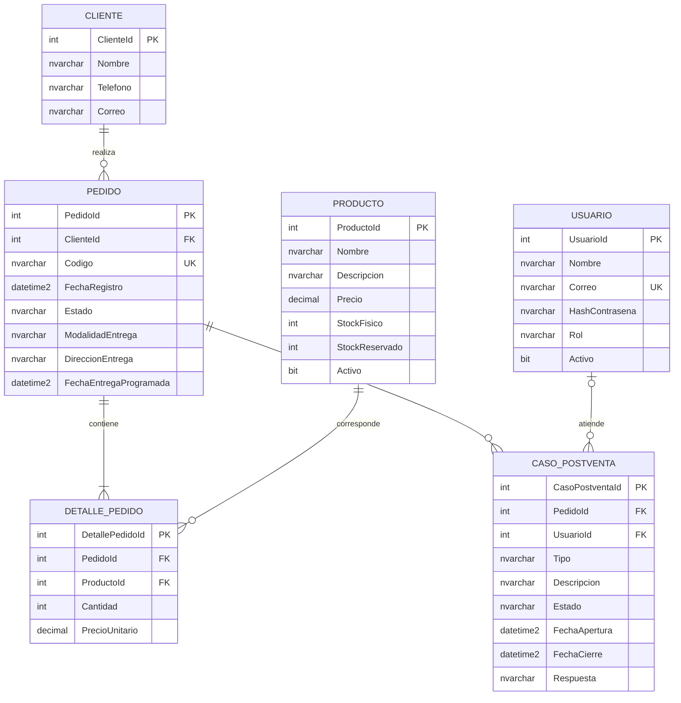

# Modelo de base de datos — Alma Floral

## Objetivo y alcance

Se propone una base de datos relacional para SQL Server que permita
gestionar clientes, productos, pedidos y casos de postventa.

Este modelo amplía el diseño del avance 02.
Su documentación no implica que la conexión con la base de datos,
la autenticación o los módulos de negocio ya estén implementados.

## Diagrama de entidades y relaciones

## Relaciones

- Un cliente puede registrar varios pedidos.
- Cada pedido pertenece a un cliente y contiene uno o más detalles.
- Cada detalle identifica un producto, su cantidad y el precio acordado.
- Un producto puede aparecer en distintos pedidos.
- Un pedido puede tener varios casos de postventa.
- Un caso puede permanecer sin responsable hasta su asignación.
- Un usuario puede atender varios casos de postventa.

## Reglas de integridad y negocio

1. Las claves primarias identifican cada registro.
   Las claves foráneas mantienen las relaciones entre las tablas.
2. El código del pedido y el correo de cada usuario son únicos.
3. La cantidad de cada detalle debe ser mayor que cero.
   Los precios no pueden ser negativos.
4. El stock físico y el reservado no pueden ser negativos.
   El reservado no puede superar al físico.
5. El stock disponible se calcula como:
   StockFisico - StockReservado.
6. Al registrar un pedido se reserva el stock disponible.
   Si se cancela antes de la preparación, se libera la reserva.
   Al entregarlo, se descuentan las unidades del stock físico
   y se libera la reserva correspondiente.
   Estas operaciones deben realizarse dentro de una transacción.
7. El precio unitario se conserva en el detalle del pedido,
   aunque posteriormente cambie el precio del producto.
   El total se calcula sumando Cantidad × PrecioUnitario.
8. Los productos con historial se desactivan;
   no se eliminan los registros relacionados con pedidos.
9. Los estados propuestos del pedido son:
   Registrado, En preparación, Listo, Entregado y Cancelado.
10. Los estados de postventa son:
    Abierto, En atención y Cerrado.
    Son independientes del estado del pedido.
11. La dirección es obligatoria cuando la modalidad es Delivery.
    Para Recojo puede quedar vacía.
12. Un caso cerrado debe registrar respuesta y fecha de cierre.
13. La contraseña se almacena mediante un hash seguro,
    nunca como texto original.
14. La consulta o solicitud de postventa requiere comprobar
    el código del pedido y los datos de contacto del cliente.

## Consideraciones de implementación

Las modificaciones del catálogo requieren acceso autorizado.
La autenticación y la validación del contacto deberán implementarse
en la aplicación; el diagrama por sí solo no proporciona esos controles.

El modelo no incluye pasarela de pagos, reembolsos automáticos
ni gestión de producción.
