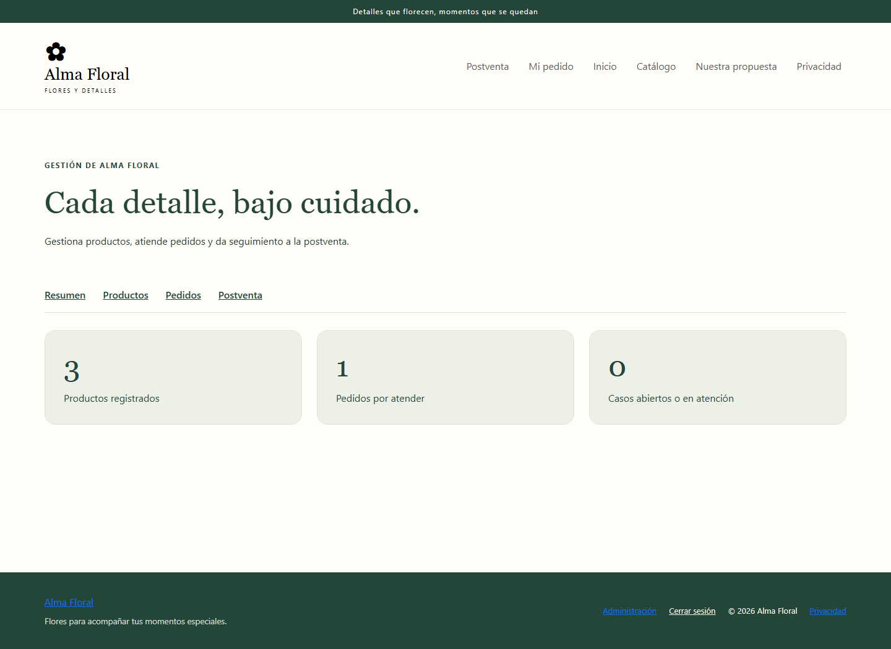
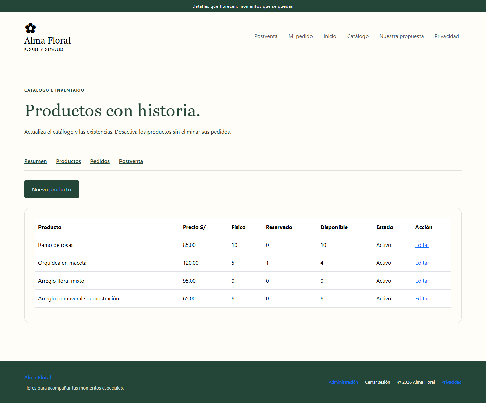
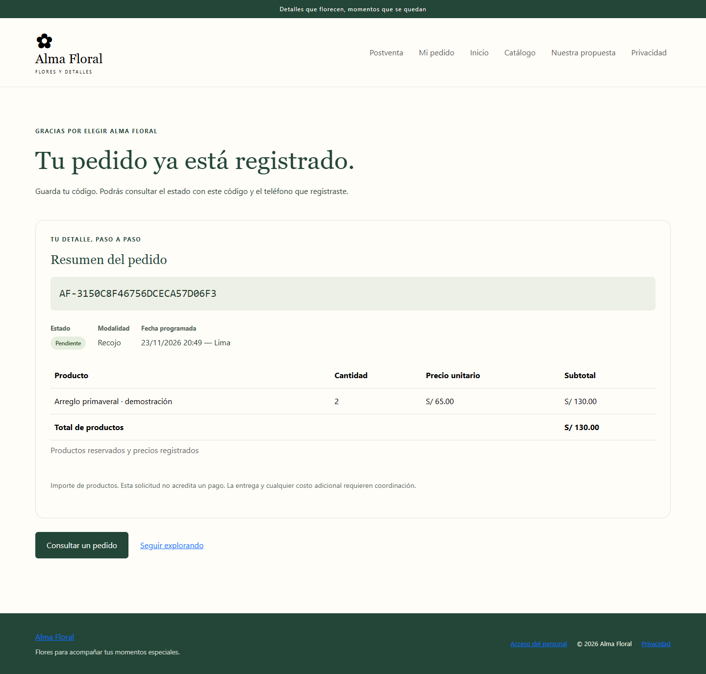
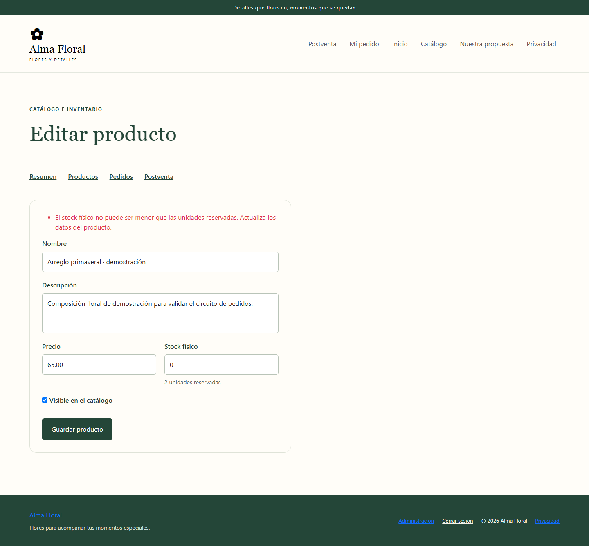
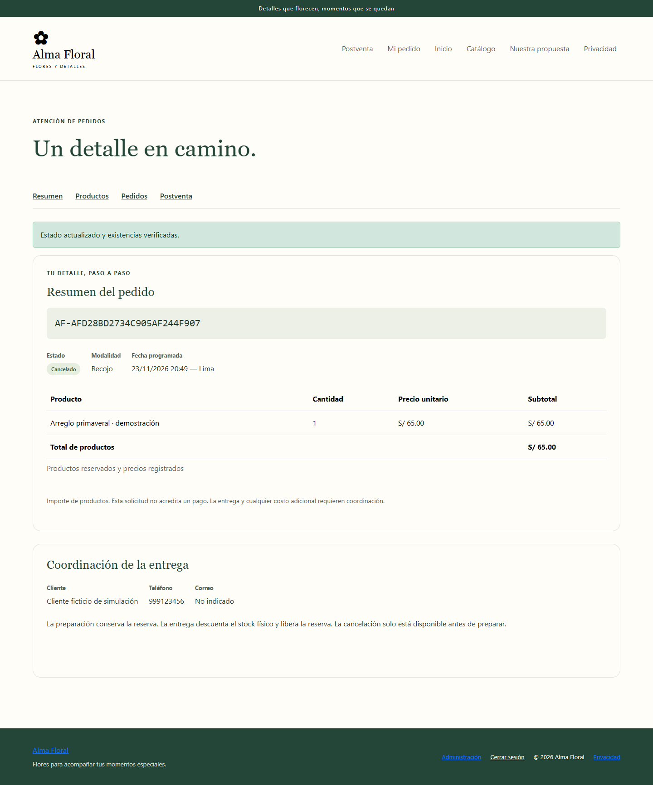
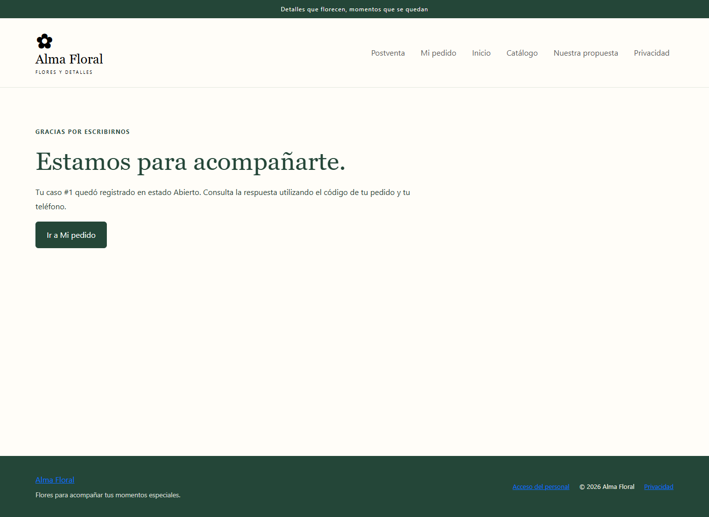
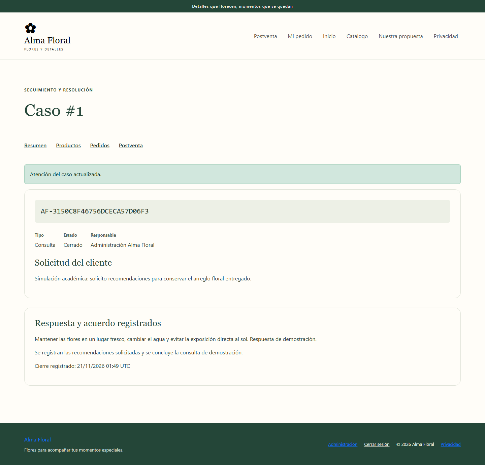
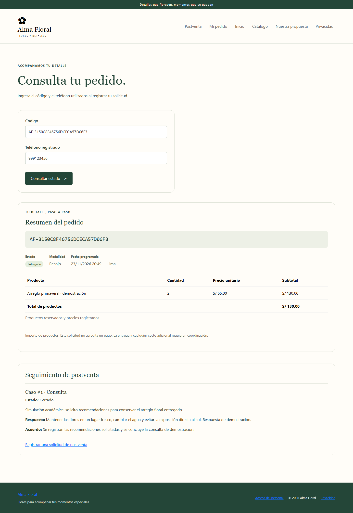
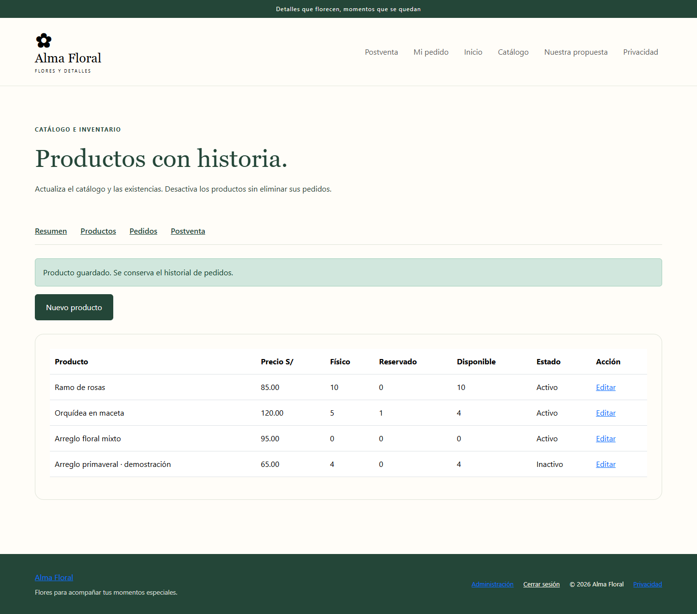

# Simulaciones del sistema Alma Floral

Las simulaciones se ejecutaron en el entorno local con SQL Server Express y datos ficticios. Cada escenario contrasta una regla, una secuencia de acciones y un resultado observable. No se presentan como operaciones de clientes reales.

## Entorno y datos

ASP.NET Core MVC .NET 10, Entity Framework Core 10.0.15, SQL Server Express, Chrome; sitio local http://localhost:5288. La cuenta administrativa se configuró mediante secretos locales. El producto de demostración es el número 4. El primer pedido histórico y su reserva no se modificaron.

## SIM01 Acceso administrativo

**Precondiciones:** aplicación y SQL Server disponibles; cuenta administrativa activa cuando el recorrido lo requiere. Los escenarios se ejecutan en el orden indicado.

**Pasos:** Abrir Administración sin sesión; probar clave incorrecta; ingresar con la cuenta autorizada.

**Resultado esperado:** El acceso anónimo exige ingreso, la clave incorrecta se rechaza y la cuenta válida abre el panel.

**Resultado obtenido:** coincidente con el esperado; comprobado desde la interfaz y, para estados y stock, mediante consultas de solo lectura.

## SIM02 Alta y consulta de producto

**Precondiciones:** aplicación y SQL Server disponibles; cuenta administrativa activa cuando el recorrido lo requiere. Los escenarios se ejecutan en el orden indicado.

**Pasos:** Registrar el arreglo de demostración con precio S/ 65 y stock físico 6; revisar inventario.

**Resultado esperado:** El producto aparece activo, con 6 unidades físicas, 0 reservadas y 6 disponibles.

**Resultado obtenido:** coincidente con el esperado; comprobado desde la interfaz y, para estados y stock, mediante consultas de solo lectura.

## SIM03 Registro y reserva de pedido

**Precondiciones:** aplicación y SQL Server disponibles; cuenta administrativa activa cuando el recorrido lo requiere. Los escenarios se ejecutan en el orden indicado.

**Pasos:** Solicitar dos unidades del producto de demostración desde el catálogo.

**Resultado esperado:** El pedido queda Pendiente, conserva precio S/ 65 y total S/ 130; físico 6, reservado 2, disponible 4.

**Resultado obtenido:** coincidente con el esperado; comprobado desde la interfaz y, para estados y stock, mediante consultas de solo lectura.

## SIM04 Protección de reservas

**Precondiciones:** aplicación y SQL Server disponibles; cuenta administrativa activa cuando el recorrido lo requiere. Los escenarios se ejecutan en el orden indicado.

**Pasos:** Intentar editar el stock físico a 0 con 2 unidades ya reservadas.

**Resultado esperado:** Se rechaza la edición; el inventario conserva sus valores previos.

**Resultado obtenido:** coincidente con el esperado; comprobado desde la interfaz y, para estados y stock, mediante consultas de solo lectura.

## SIM05 Preparación y entrega

**Precondiciones:** aplicación y SQL Server disponibles; cuenta administrativa activa cuando el recorrido lo requiere. Los escenarios se ejecutan en el orden indicado.

**Pasos:** Pasar a En preparación; intentar cancelar; continuar a Listo y Entregado.

**Resultado esperado:** La cancelación tardía se rechaza. Al entregar: físico 4, reservado 0 y disponible 4.

**Resultado obtenido:** coincidente con el esperado; comprobado desde la interfaz y, para estados y stock, mediante consultas de solo lectura.

## SIM06 Cancelación antes de preparar

**Precondiciones:** aplicación y SQL Server disponibles; cuenta administrativa activa cuando el recorrido lo requiere. Los escenarios se ejecutan en el orden indicado.

**Pasos:** Registrar otro pedido de una unidad y cancelarlo mientras está Pendiente.

**Resultado esperado:** El pedido queda Cancelado; se libera su reserva y el stock físico continúa en 4.

**Resultado obtenido:** coincidente con el esperado; comprobado desde la interfaz y, para estados y stock, mediante consultas de solo lectura.

## SIM07 Apertura de postventa

**Precondiciones:** aplicación y SQL Server disponibles; cuenta administrativa activa cuando el recorrido lo requiere. Los escenarios se ejecutan en el orden indicado.

**Pasos:** Usar el código del pedido entregado y su teléfono; registrar una consulta.

**Resultado esperado:** El caso queda Abierto y vinculado al pedido, sin responsable hasta iniciar la atención.

**Resultado obtenido:** coincidente con el esperado; comprobado desde la interfaz y, para estados y stock, mediante consultas de solo lectura.

## SIM08 Atención y cierre del caso

**Precondiciones:** aplicación y SQL Server disponibles; cuenta administrativa activa cuando el recorrido lo requiere. Los escenarios se ejecutan en el orden indicado.

**Pasos:** Iniciar atención; intentar cerrar sin respuesta; registrar respuesta y acuerdo; cerrar.

**Resultado esperado:** Se rechaza el cierre incompleto y luego se guarda Cerrado, con responsable y fecha.

**Resultado obtenido:** coincidente con el esperado; comprobado desde la interfaz y, para estados y stock, mediante consultas de solo lectura.

## SIM09 Seguimiento y privacidad

**Precondiciones:** aplicación y SQL Server disponibles; cuenta administrativa activa cuando el recorrido lo requiere. Los escenarios se ejecutan en el orden indicado.

**Pasos:** Consultar con código y teléfono válidos; repetir con teléfono incorrecto.

**Resultado esperado:** El cliente ve Entregado y el caso Cerrado. El teléfono incorrecto no obtiene el resumen.

**Resultado obtenido:** coincidente con el esperado; comprobado desde la interfaz y, para estados y stock, mediante consultas de solo lectura.

## SIM10 Uso en móvil

**Precondiciones:** aplicación y SQL Server disponibles; cuenta administrativa activa cuando el recorrido lo requiere. Los escenarios se ejecutan en el orden indicado.

**Pasos:** Abrir la solicitud de postventa a 390 × 844 píxeles.

**Resultado esperado:** Los campos se distribuyen en una columna, sin desbordamiento horizontal.

**Resultado obtenido:** coincidente con el esperado; comprobado desde la interfaz y, para estados y stock, mediante consultas de solo lectura.

## SIM11 Desactivación con historial

**Precondiciones:** aplicación y SQL Server disponibles; cuenta administrativa activa cuando el recorrido lo requiere. Los escenarios se ejecutan en el orden indicado.

**Pasos:** Desactivar el producto de demostración y revisar catálogo y pedidos.

**Resultado esperado:** El producto deja de mostrarse en el catálogo público; pedidos, detalles y caso permanecen guardados.

**Resultado obtenido:** coincidente con el esperado; comprobado desde la interfaz y, para estados y stock, mediante consultas de solo lectura.

## Registros de referencia

- Pedido entregado: `AF-3150C8F46756DCECA57D06F3`.
- Pedido cancelado: `AF-AFD28BD2734C905AF244F907`.
- Caso de postventa: `1`.
- Stock final del producto de demostración: físico 4, reservado 0 y disponible 4; producto desactivado.
- Pruebas automatizadas complementarias: 33 aprobadas y 0 con errores.
- Los rechazos de las simulaciones son validaciones previstas, no incidencias atribuidas ficticiamente al sistema.
